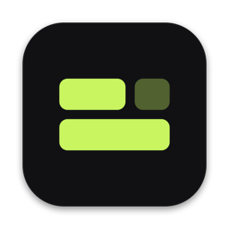
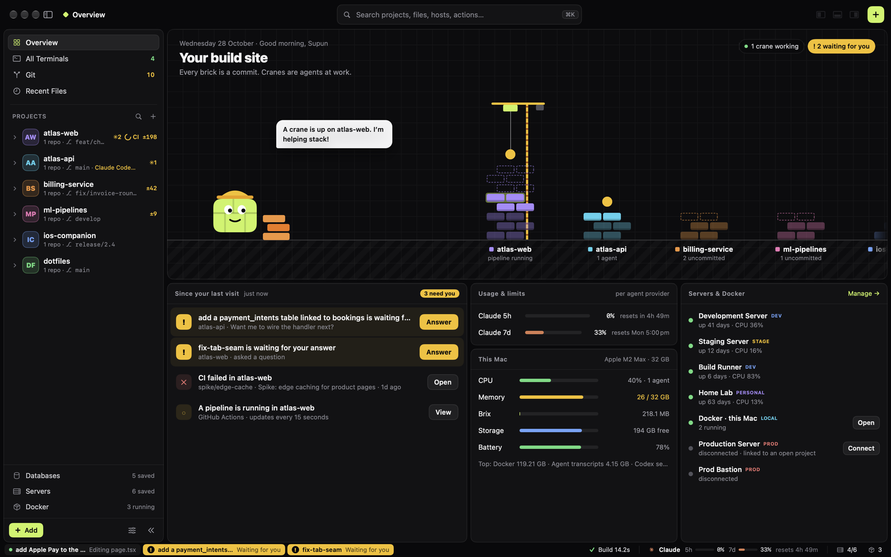
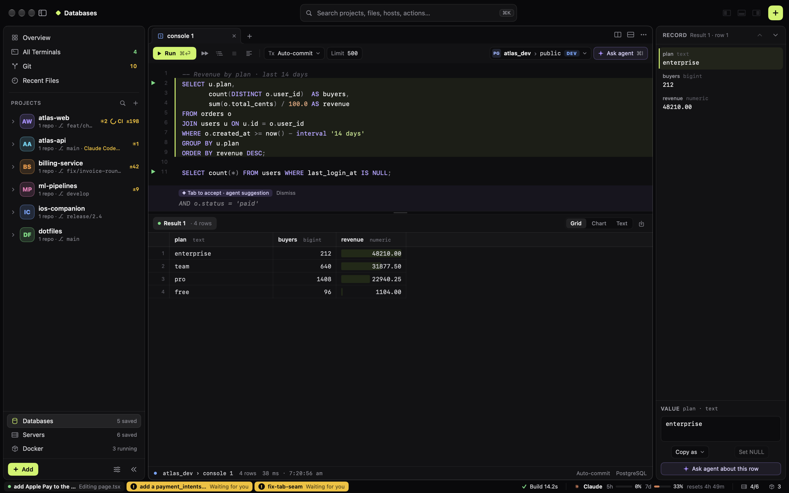
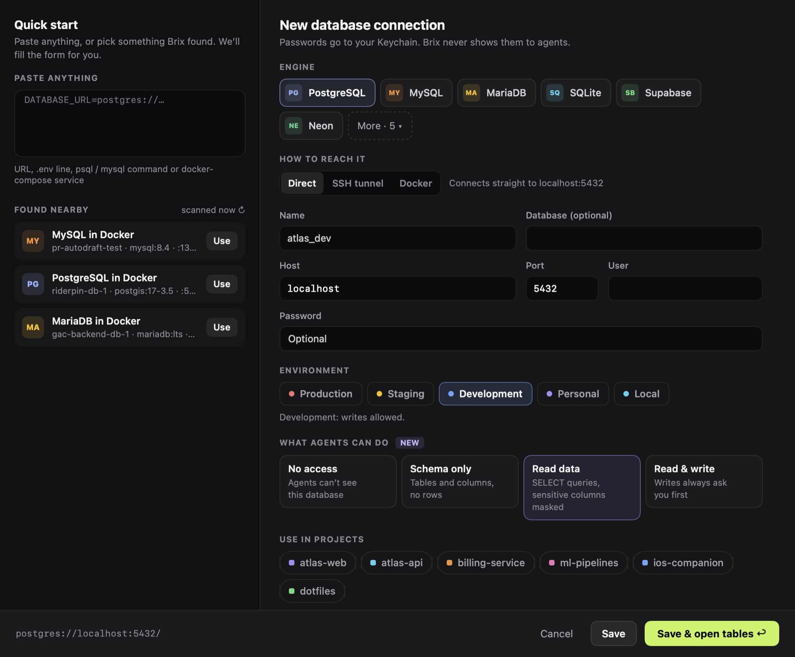
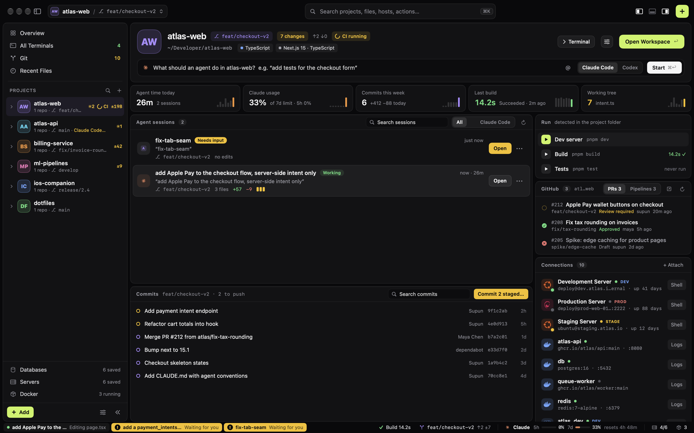
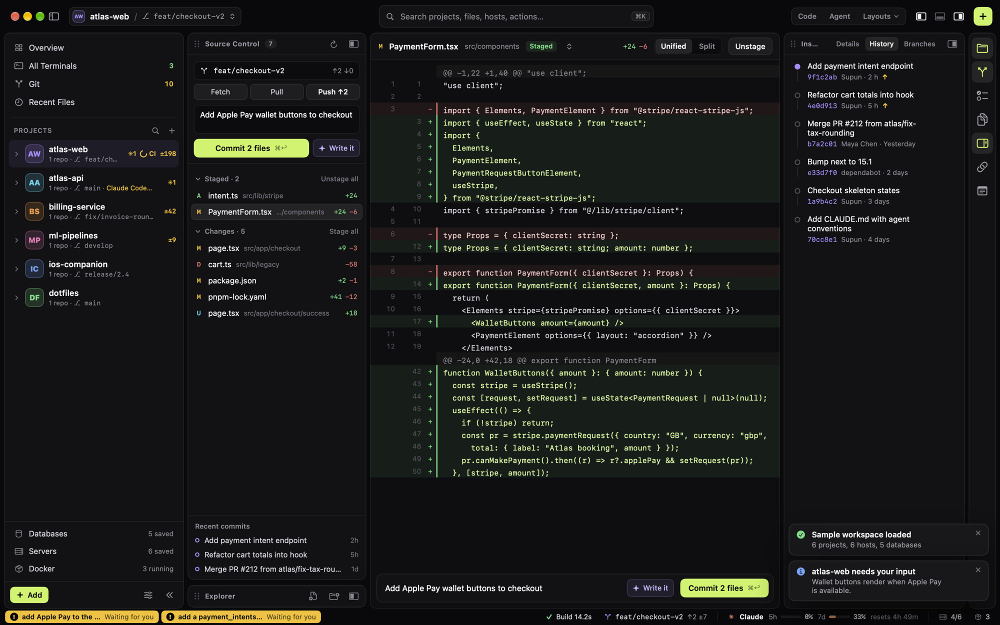

<p align="center">
  
</p>

<h1 align="center">Brix</h1>

<p align="center">
  <b>Your agents lay the bricks. You run the site.</b><br>
  A native macOS workspace for developers who build with AI coding agents.
</p>

<p align="center">
  <a href="https://github.com/spmsupun/brix/releases"></a>
  
  
  <a href="LICENSE"></a>
</p>

<p align="center">
  
</p>

---

You have three Claude Code sessions running, a Codex agent in another repo, two terminals tailing logs, an SSH session on staging, a Postgres client open on the side and a browser tab watching CI. Ten windows, zero overview.

**Brix puts all of it in one window.** Projects, agent sessions, terminals, SSH hosts, databases, Docker and Git, side by side, with each project keeping its own layout. Agents get a calm place to work, and you get one screen that tells you who is busy, who is waiting for you and what changed.

> **Public beta.** Brix is young and moving fast, so expect rough edges. Bug reports are gold.

## The build site

Home is a little construction site. Every project is a tower: today's commits are bright bricks, older history is compressed into dimmer floors, and uncommitted work shows as dashed scaffolding. Every agent that is working raises a crane over its tower; an agent waiting for you lights an amber beacon. The buddy on the left reads the room: idle, working, waiting on you or celebrating a fresh push.

Underneath: what needs you since your last visit (agents waiting, failed builds, unpushed commits, unreachable servers), your agent plan usage, this Mac's CPU, memory and storage (including what Brix itself uses), and your servers and Docker at a glance.

## What's inside

<table>
<tr>
<td width="50%" valign="top">

### Agents, side by side
Start Claude Code, Codex, Gemini CLI, OpenCode or any CLI agent in a project. Brix reads each agent's screen to know when it is working, done, or asking you something, and puts a chip in the status bar so you never miss a question. Split panes like Chrome tabs: drag a tab onto a pane to split it, any way you like.

</td>
<td width="50%" valign="top">

### Every project, its own layout
Explorer, editor, terminals, agents, source control, plan and Record panels dock anywhere. Each project remembers its own arrangement, its sessions and its open files, and restores them after a restart. A folder of several repositories shows each repo with its branch, changes and agents.

</td>
</tr>
<tr>
<td valign="top">

### A real database client
PostgreSQL, MySQL, MariaDB, SQLite, Supabase, Neon and friends. A connection tree in the sidebar, table and SQL console tabs, a native grid with staged edits (nothing is written until you submit, and it rolls back if any row didn't match), a foreign-key peek, a record inspector and charts for query results. Production is read-only in code, not just in the UI.

</td>
<td valign="top">

### Agents can see your data, safely
Each connection has an **agent access** level: no access, schema only, read data, or read and write. Agents use a small `brix-db` command that only reaches databases linked to their project, masks columns that look sensitive, and asks you before any write. Passwords live in the Keychain and never reach an agent.

</td>
</tr>
<tr>
<td valign="top">

### SSH, Docker and Git, in reach
SSH hosts from your `~/.ssh/config` with a remote file browser. Docker containers, stacks, volumes and images, local or on a server. Git status, a fast native diff, staging and commits, plus GitHub pull requests and running pipelines through `gh`, even with several GitHub accounts.

</td>
<td valign="top">

### Brings your setup with it
Paste a connection URL, a `.env` line, a `psql` command or a compose service and Brix fills the form. It finds databases nearby: `.env` files in your projects, Docker containers, local servers. It imports SSH hosts and databases from JetBrains IDEs and VS Code. A `brix.json` in each repo carries the project's layout and connections (never passwords).

</td>
</tr>
</table>

<p align="center">
  
  <br><sub>A project workspace: an agent at work, source control, a table opened from the project's database and its record panel.</sub>
</p>

<table>
<tr>
<td></td>
<td></td>
</tr>
<tr>
<td align="center"><sub>SQL console: run the statement under the caret, results with inline bars.</sub></td>
<td align="center"><sub>New connection: paste anything, or pick something Brix found nearby.</sub></td>
</tr>
<tr>
<td></td>
<td></td>
</tr>
<tr>
<td align="center"><sub>Project overview: sessions, commits, pull requests, pipelines and run tasks.</sub></td>
<td align="center"><sub>Review changes, stage and commit without leaving the workspace.</sub></td>
</tr>
</table>

## Install the beta

With [Homebrew](https://brew.sh):

```sh
brew install --cask spmsupun/tap/brix
```

Or by hand:

1. Download **Brix-…-macOS.zip** from the [releases page](https://github.com/spmsupun/brix/releases).
2. Unzip it and move **Brix.app** to Applications.
3. Open it. Builds are signed with a Developer ID and notarised by Apple, so macOS opens them like any other app.
4. Add a project folder, or choose **Load sample workspace** to look around with demo data.

Brix runs on macOS 14 Sonoma or later, on Apple silicon and Intel.

## Build from source

You need Xcode 16 or later and [XcodeGen](https://github.com/yonaskolb/XcodeGen).

```sh
brew install xcodegen
git clone https://github.com/spmsupun/brix.git
cd brix
./build.sh                 # generates the Xcode project and builds Debug
./build.sh test            # runs the unit tests
open build/dd/Build/Products/Debug/Brix.app
```

Or run `xcodegen generate` and open `Brix.xcodeproj` in Xcode.

## Privacy and safety

- **Nothing leaves your Mac.** No accounts, no analytics, no telemetry. Brix talks only to the servers, databases and tools you point it at.
- **Secrets live in the Keychain.** SSH and database passwords are never written to disk in plain text, never shown in the UI and never passed to agents.
- **Production is careful by default.** Production hosts and databases ask before connecting or writing; production databases open read-only and the data screen never writes to them.
- **Why the App Sandbox is off.** Brix runs your shells and agents, reads your `~/.ssh` config and talks to the Docker socket, which the sandbox does not allow. That is also why it ships here and not in the Mac App Store. Hardened Runtime stays on.

## Under the hood

SwiftUI first, AppKit where it is clearly better: the terminal ([SwiftTerm](https://github.com/migueldeicaza/SwiftTerm)), the code editor, the data grid and the diff are native AppKit views so they stay fast with big content. Databases use [PostgresNIO](https://github.com/vapor/postgres-nio), [MySQLNIO](https://github.com/vapor/mysql-nio) and [GRDB](https://github.com/groue/GRDB.swift), with one shared session per connection. Host and database logos come from [Simple Icons](https://simpleicons.org) (CC0).

Want every detail (keyboard shortcuts, where each file lives, how agents are detected, how imports work)? Read the **[full guide](docs/GUIDE.md)**.

## Roadmap

- Automatic updates
- More agents' usage and limits in the status bar
- Your ideas: [open an issue](https://github.com/spmsupun/brix/issues)

## Contributing

Issues and pull requests are welcome. Keep changes small and focused, run `./build.sh test` before you send them, and describe what you tested. For a larger change, open an issue first so we can agree on the shape.

## License

[MIT](LICENSE) © 2026 Supun Praneeth
